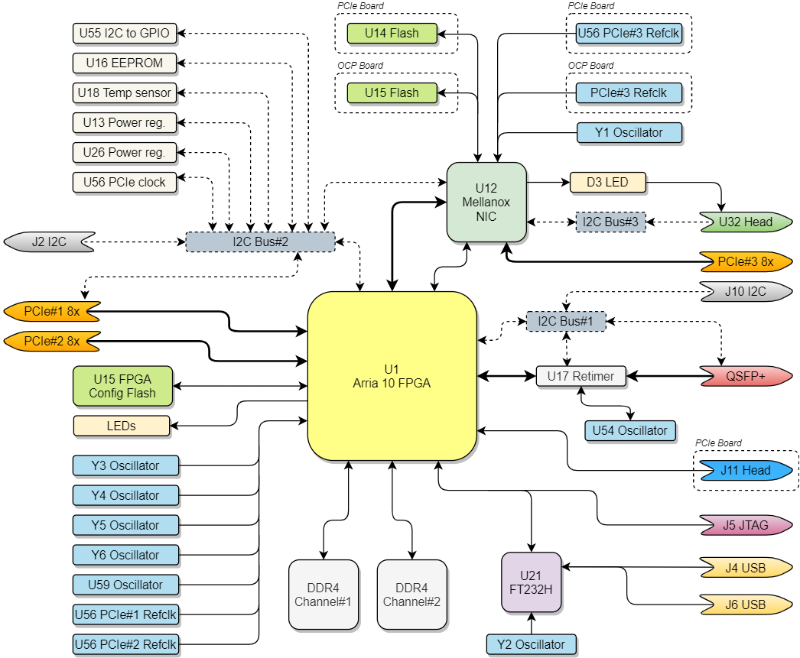

# Hardware overview

> Status: reported (community reverse engineering), identification verified on this card
> Source: [tow3rs/catapult-v3-smartnic-re](https://github.com/tow3rs/catapult-v3-smartnic-re), BOM + photos

## Main components

| Ref | Part | Function | Notes |
|-----|------|----------|-------|
| U1 | Altera **Arria 10** `10AXF40GAA` | main FPGA | non-standard P/N, equivalent to 10AX115 class; see [fpga.md](fpga.md) |
| U2-U6, U7-U11 | SK hynix `H5AN4G6NAFR-UHC` | DDR4 SDRAM, 4 Gb each | 9 devices → two 72-bit channels, 4.5 GB usable |
| U12 | Mellanox `MT27524A1` / `MT27711A0` | NIC ASIC | ConnectX-3 Pro or ConnectX-4 Lx, see [mellanox-nic.md](mellanox-nic.md) |
| U17 | TI `DS250DF810` | 8-channel 25 Gb/s retimer | between FPGA and QSFP+, I2C address 0x22 |
| U19 | Micron `N25Q00AA` | 1 Gb (128 MB) QSPI config flash | holds the FPGA bitstream, `EPCQL1024` compatible |
| U14 | Winbond `25Q128FVSG` | 128 Mb SPI flash | PCIe variant; used by the OpenCL BSP / SFL flow |
| U16 | ST `M24128` | 128 Kb I2C EEPROM | board identification |
| U18 | TI `TMP411` | temperature sensor | I2C 0x4C |
| U13 | TI `LM25066` | hot-swap / power monitor | I2C 0x42 |
| U26 | MPS `MP2953B` | multiphase VR controller | I2C 0x40 |
| U55 | TI `PCA9535` | 16-bit I2C GPIO expander | I2C 0x27 |
| U21 | FTDI `FT232H` | USB ↔ JTAG programmer | 12 MHz crystal (Y2), USB-B on bracket |
| U56 | Renesas `9DBV0441` | 4-output PCIe clock buffer | 100 MHz to FPGA + NIC + edge |
| Y1 | 100 MHz oscillator | NIC reference | |
| Y3 | 266.667 MHz | DDR4 bottom channel refclk | |
| Y4 | 266.667 MHz | DDR4 top channel refclk | |
| Y5 | 644.53125 MHz | QSFP+/retimer reference | |
| Y6 | 644.53125 MHz | FPGA ↔ NIC XCVR reference | 156.25 MHz on OCP variant |
| U59 | 100 MHz | FPGA `CLKUSR` / general purpose clock | used as the "board clock" in examples |
| U54 | 25 MHz | retimer reference | |

Power conversion is split into several rails (VCore, VCCIO 1.8 V, 1.2 V, 3.3 V, DDR4
VDD/VTT, transceiver rails). See [power.md](power.md); the exact rail map is still
incomplete.

## Interfaces

| Interface | Lanes | FPGA pins | Notes |
|-----------|-------|-----------|-------|
| PCIe #1 | 8 × Gen3 | `AN33…AH30`, PERST `AW16` | edge connector lanes 0-7 |
| PCIe #2 | 8 × Gen3 | `AE32…Y38`, PERST `AV18` | edge connector lanes 8-15 |
| NIC PCIe | 8 × Gen3 | — | goes to the OCuLink connector (not the edge) |
| NIC XCVR | 4 × 25 G | `H31…B34` | FPGA ↔ ConnectX, reference Y6 644.53125 MHz |
| QSFP+ | 4 × 25 G | `W33…` | through U17 retimer |
| DDR4 top | 72-bit | `L5…W10` | refclk Y4 |
| DDR4 bottom | 72-bit | `AN3…AW6` | refclk Y3 |
| I2C #1 | 2 | `L20/K20` | retimer, QSFP cage, J10 |
| I2C #2 | 2 | `K21/J23` | EEPROM, sensors, VRs, PCIe clock, J2 |
| I2C #3 | 2 | via U32/J9 | Mellanox management |
| JTAG | 4 | dedicated | FT232H on-board, J5 header |
| GPIO | 3 | `A24/A25/A26` | J11 (PCIe variant only) |

## Mechanical

- Full-height, full-length PCIe CEM card (312 mm class), single-slot cooler mounting holes.
- QSFP+ cage at the bracket, optical/copper 40-50G.
- 6-pin auxiliary power connector at the top-left corner of the PCB (12 V).
- Fan header J8 (4-pin footprint, 3 pins used) and a bare fan mounting area.

Photographs: [../hardware/photos/](../hardware/photos/).

## What is *not* on the card

- No video output, no UART header, no PS/2, no SD card.
- No HPS (hard processor system): the Arria 10 part is a GX, not an SX.
- No user push-buttons. The only user I/O are the 9 LEDs, J11 GPIO and the I2C/XCVR pins.

This matters when choosing a "hello world": there is no serial console, so the simplest
observable output is the LED bank. See [bringup/02-hello-world.md](../bringup/02-hello-world.md).
